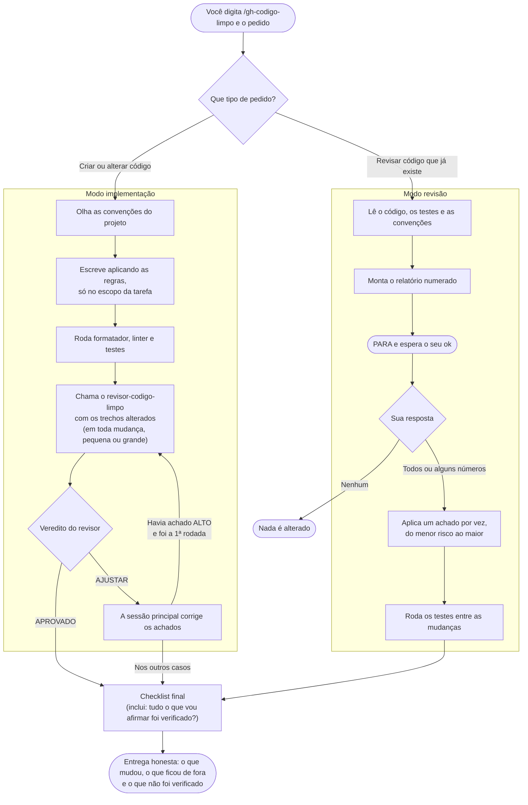

# gh-codigo-limpo

Skill para o [Claude Code](https://claude.com/claude-code) que faz a IA escrever e revisar código pensando em quem vai ler depois: nomes que revelam a intenção, variáveis explicativas, uma ideia por linha, retorno antecipado e funções pequenas, com SOLID, DRY, KISS e YAGNI na medida certa, sem inflar o código.

Ela vem com um subagente, o `revisor-codigo-limpo`, que lê cada mudança com o contexto limpo, como alguém que nunca viu o projeto, e aponta onde a leitura trava.

A skill só age quando você a chama com `/gh-codigo-limpo`. Fora disso, o Claude Code trabalha normalmente e não aplica o fluxo dela.

## O que tem aqui

```
skills/gh-codigo-limpo/
├── SKILL.md                    # regras, os dois modos de uso, honestidade e checklist
└── references/principios.md    # cada regra com exemplo de antes e depois e quando não se aplica
agents/
└── revisor-codigo-limpo.md     # subagente revisor, somente leitura
```

## Como funciona

A skill tem dois modos. No **modo implementação**, ela aplica as regras enquanto escreve e chama o revisor em toda mudança. No **modo revisão**, ela mostra um relatório numerado e só altera alguma coisa depois do seu ok.



> Este README e o diagrama servem só para explicar a skill. Eles não fazem parte do que é instalado: a skill é apenas a pasta `skills/gh-codigo-limpo/` e o subagente é o arquivo `agents/revisor-codigo-limpo.md`.

## Instalação

Copie a skill e o subagente para a pasta do Claude Code. Use `~/.claude/` para ter em todos os projetos, ou `.claude/` dentro de um projeto para ter só nele.

**macOS / Linux**

```bash
git clone https://github.com/GuilhermeOliveira0/gh-codigo-limpo.git
mkdir -p ~/.claude/skills ~/.claude/agents
cp -r gh-codigo-limpo/skills/gh-codigo-limpo ~/.claude/skills/
cp gh-codigo-limpo/agents/revisor-codigo-limpo.md ~/.claude/agents/
```

**Windows (PowerShell)**

```powershell
git clone https://github.com/GuilhermeOliveira0/gh-codigo-limpo.git
New-Item -ItemType Directory -Force "$HOME\.claude\skills", "$HOME\.claude\agents" | Out-Null
Copy-Item -Recurse gh-codigo-limpo\skills\gh-codigo-limpo "$HOME\.claude\skills\"
Copy-Item gh-codigo-limpo\agents\revisor-codigo-limpo.md "$HOME\.claude\agents\"
```

Abra uma nova sessão do Claude Code depois de copiar.

## Como usar

Digite `/gh-codigo-limpo` seguido do que você quer. O texto depois da barra decide o modo.

**Implementar ou alterar código**

```
/gh-codigo-limpo cria um endpoint que lista os pedidos pagos do cliente
/gh-codigo-limpo corrige o cálculo de frete em src/frete.ts
```

**Revisar código que já existe**

```
/gh-codigo-limpo revisa src/pedidos.ts
/gh-codigo-limpo limpa a pasta src/pagamentos sem mudar o comportamento
```

O relatório da revisão vem numerado. Responda com os números que quer aplicar, "todos" ou "nenhum".

Se você digitar só `/gh-codigo-limpo`, sem nada depois, ela pergunta o que fazer antes de mexer em qualquer arquivo.

A skill vale só para o pedido feito junto com a barra (e para as respostas que fazem parte dele, como a aprovação do relatório). Os pedidos seguintes que vierem sem `/gh-codigo-limpo` são atendidos normalmente, sem o fluxo da skill.

## Princípios que guiam a skill

- **Comportamento preservado vem primeiro.** Refatorar é mudar a forma, não o resultado.
- **Convenções do projeto valem mais que preferência.** Idioma dos nomes, estilo e padrões que já existem são seguidos.
- **Sem inflar o código.** Abstração só quando resolve um problema que existe hoje.
- **Escopo fechado.** Na implementação, só o que a tarefa pede; o resto vira sugestão no final.
- **Honestidade.** A entrega diz o que foi verificado, o que foi suposto e o que ficou de fora.
